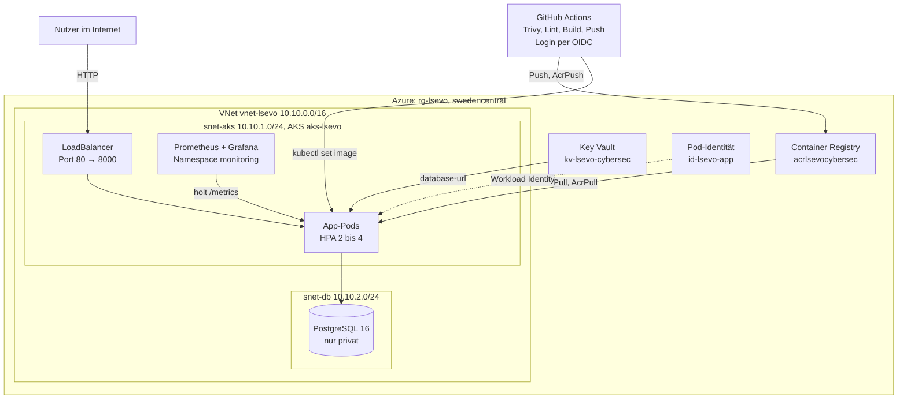
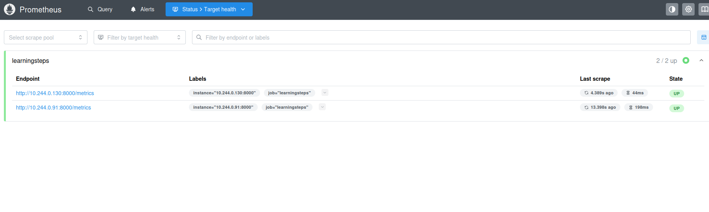
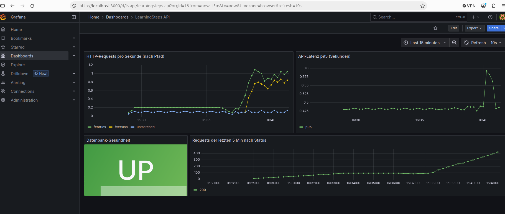

# LearningSteps Evolution

Cybersteps, Modul 3, Projekt 2. Die LearningSteps-App (FastAPI + PostgreSQL) wird von manuell gebauten VMs zu einer automatisierten, selbstheilenden und überwachbaren Umgebung auf Azure weiterentwickelt.

- **Infrastruktur als Code:** Terraform (VNet, AKS, PostgreSQL Flexible Server, Key Vault, ACR)
- **Container:** Docker, Azure Container Registry
- **Orchestrierung:** Azure Kubernetes Service mit HPA
- **Secrets:** Azure Key Vault + Workload Identity (keine gespeicherten Schlüssel)
- **CI/CD:** GitHub Actions mit OIDC-Login und DevSecOps (Trivy, GitHub Secret Scanning)
- **Monitoring:** Prometheus und Grafana in AKS

## Architektur



Nur der LoadBalancer ist öffentlich. Die Datenbank liegt in einem delegierten Subnet ohne öffentlichen Zugang. Prometheus und Grafana sind nur per `kubectl port-forward` erreichbar.

## Repository-Struktur

```
api/                    FastAPI-Code (inkl. /version und /metrics)
infra-terraform/        Terraform: versions, variables, main (Netz), services, aks, outputs
k8s-manifests/          00-namespace bis 40-hpa (App), 50-prometheus, 51-grafana
.github/workflows/      ci-cd.yml
Dockerfile              python:3.12-slim, läuft als uid 10001
.trivyignore            bewusst akzeptierte Funde mit Begründung
```

## Ressourcen

| Ressource | Name | SKU / Wert |
| --- | --- | --- |
| Resource Group | rg-lsevo | swedencentral |
| VNet / Subnets | vnet-lsevo | 10.10.0.0/16; snet-aks 10.10.1.0/24; snet-db 10.10.2.0/24 (delegiert) |
| AKS | aks-lsevo | 1 Node Standard_D2s_v6, Tier Free, Azure CNI Overlay, RBAC, OIDC, Workload Identity |
| PostgreSQL | psql-lsevo-cybersec | Flexible Server 16, B_Standard_B1ms, 32 GB, nur privat |
| Key Vault | kv-lsevo-cybersec | Standard, Secrets `db-password`, `database-url` |
| Container Registry | acrlsevocybersec | Basic, Admin-Benutzer aus |

Region `swedencentral`, weil PostgreSQL Flexible Server in `germanywestcentral` für Azure for Students gesperrt ist.

## CI/CD-Pipeline

Jeder Push startet `.github/workflows/ci-cd.yml`. Die Jobs laufen nacheinander; scheitert einer, werden die folgenden übersprungen.

1. **security:** Trivy prüft Abhängigkeiten, eingecheckte Secrets und IaC (Terraform, Kubernetes, Dockerfile). HIGH oder CRITICAL bricht ab.
2. **build:** ruff (Lint), Docker-Build, Smoke-Test, Trivy-Image-Scan, dann Azure-Login per OIDC und Push in die ACR. Das Image-Tag ist der Commit-Hash.
3. **deploy:** `kubectl set image` und `kubectl rollout status` auf AKS.

Die Pipeline hat nur `AcrPush` auf die ACR und die `Azure Kubernetes Service Cluster User Role` auf AKS. Das Federated Credential erlaubt nur den Branch `main`. Es gibt kein Client-Secret. `terraform apply` läuft bewusst nicht in der Pipeline, weil der State Geheimnisse enthält.

## Nachweise

| Erfolgskriterium | Beleg |
| --- | --- |
| Continuous Deployment | Commit `7b7778d`, Run 45035445934: `GET /version` vorher 404, nachher 200 |
| Security: verwundbares Paket | Run 45035894362 rot: `PyYAML==5.3`, 2 × CRITICAL (CVE-2020-14343, CVE-2020-1747), build und deploy übersprungen |
| Security: unsichere Terraform-Regel | Run 45036098930 rot: 5 Funde (HIGH: 3, CRITICAL: 2), build und deploy übersprungen |
| Grünlauf nach Rücknahme | Run 45036474437: security, build, deploy erfolgreich |
| Selbstheilung | Pod gelöscht, Ersatz nach 3 s gestartet, nach 36 s wieder 2/2 Pods bereit, `GET /entries` 200 |
| Monitoring | Commits `719eff1`, `e3217fc`; Runs 45038117028, 45039056018; Prometheus 2/2 UP |
| Infrastructure Recovery | bitte ergänzen (`terraform destroy` und `apply`) |





Das Dashboard zeigt Requests pro Sekunde nach Pfad, die Latenz p95, die Datenbank-Gesundheit (`db_up`) und die Requests der letzten 5 Minuten nach Status.

## Sicherheitsentscheidungen

- Das DB-Passwort erzeugt Terraform zufällig und legt es im Key Vault ab. Es steht nie im Code.
- Die Pods lesen `database-url` per Workload Identity ohne gespeicherten Schlüssel (nur Get/List).
- Die Pipeline nutzt OIDC statt Client-Secret, mit minimalen Rechten und Bindung an `main`.
- Die Pods laufen ohne Root, mit `readOnlyRootFilesystem`, ohne Capabilities und mit gesetzten Requests und Limits.
- Die Datenbank ist nur privat erreichbar, SSL ist erzwungen (`PGSSLMODE=require`).
- Scans laufen vor dem Push, ein verwundbares Image erreicht die ACR nie.
- Der Terraform-State bleibt lokal. `.gitignore` schließt `.env`, `*.tfstate*`, `.terraform/`, `*.tfvars`, `kubeconfig`, `*.pem` und `*.key` aus.

Bewusst akzeptiert (`.trivyignore`, Student-Budget): AKS-API ohne IP-Beschränkung (AZU-0041, wechselnde Runner-IPs), keine Network Policy (AZU-0043, erfordert Neuaufbau), Key Vault ohne Netzwerk-ACL (AZU-0013, Private Endpoint kostet extra).

## Bekannte Grenzen

- Keine Unit-Tests, nur Lint und Smoke-Test.
- `k8s-manifests/20-deployment.yaml` enthält noch das Tag `v1`. Die Pipeline setzt das Image nur im laufenden Cluster.
- Prometheus, Grafana und das Secret `grafana-admin` werden manuell per `kubectl` eingespielt.
- `/metrics` ist über den öffentlichen LoadBalancer erreichbar (enthält keine Daten).

## Nutzung

```bash
# Infrastruktur (Subscription-ID per Umgebungsvariable)
export ARM_SUBSCRIPTION_ID=<SUBSCRIPTION_ID>
cd infra-terraform && terraform init && terraform apply

# Cluster-Zugriff und öffentliche IP
az aks get-credentials -g rg-lsevo -n aks-lsevo --overwrite-existing
kubectl get svc learningsteps -n learningsteps

# Grafana lokal öffnen
kubectl port-forward -n monitoring svc/grafana 3000:3000

# Kosten sparen in Pausen (erst AKS, dann PostgreSQL)
az aks stop -g rg-lsevo -n aks-lsevo
az postgres flexible-server stop -g rg-lsevo -n psql-lsevo-cybersec
```

Ausführlicher Projektbericht: bitte ergänzen (Link oder Datei).
